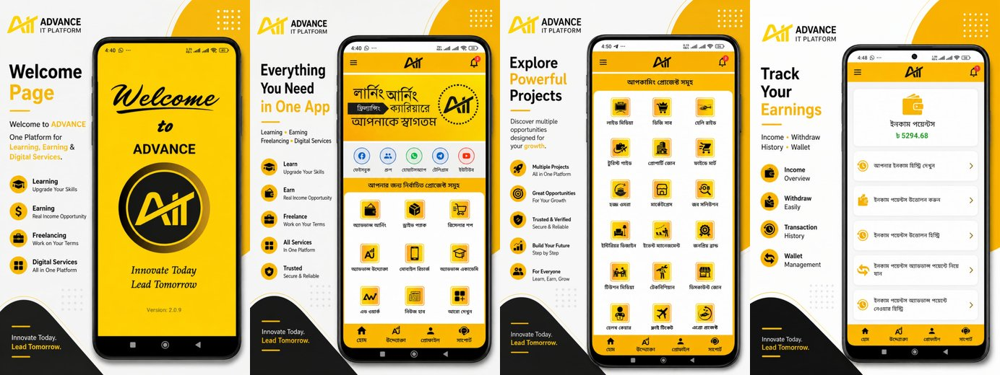
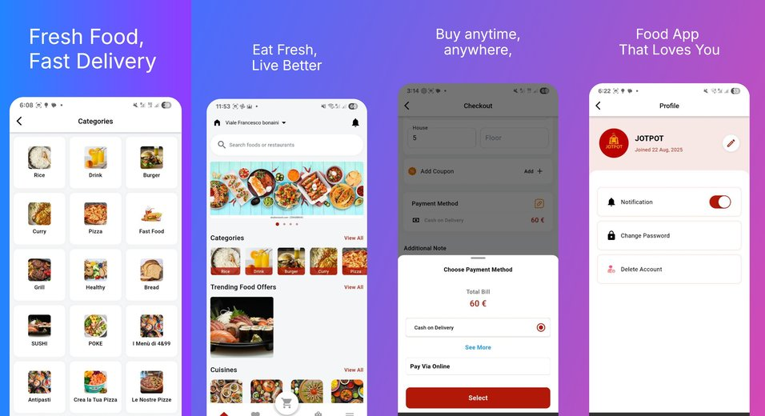
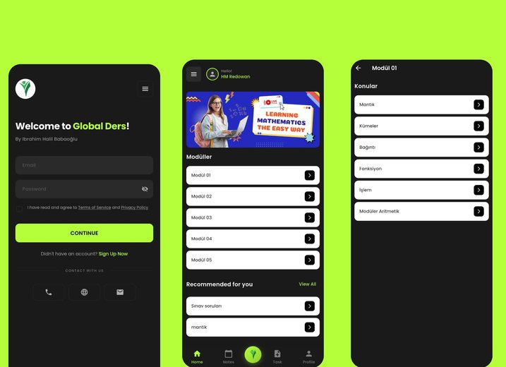
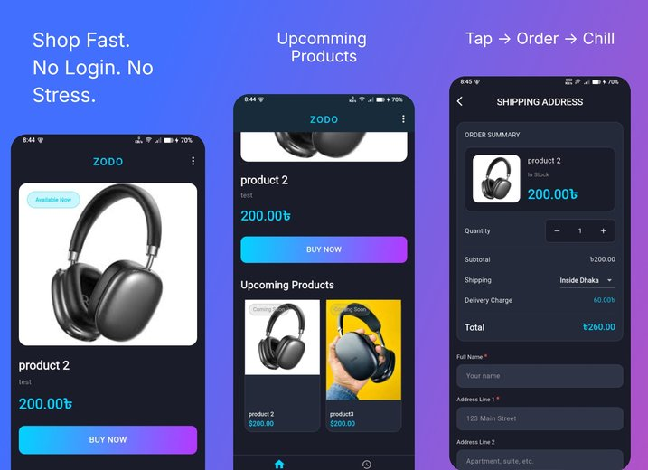
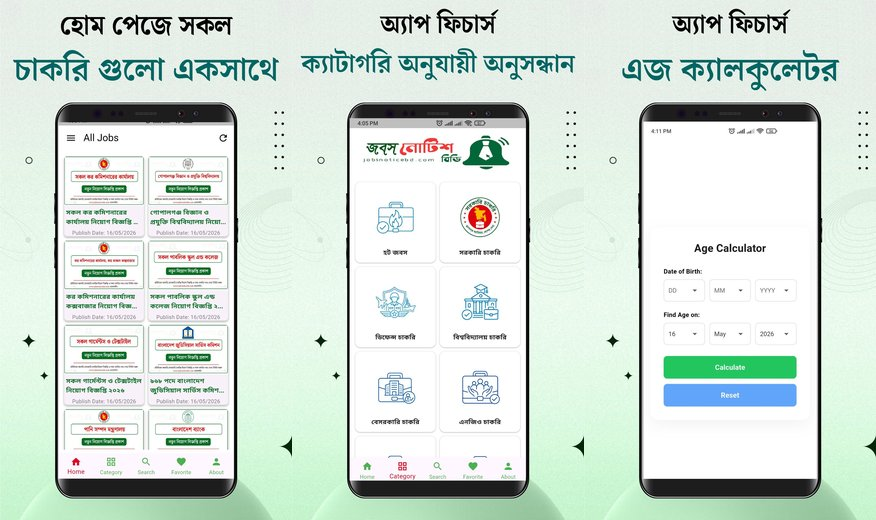

# Hi, I'm Abdul Halim 👋

**Full-stack mobile app developer from Dhaka, Bangladesh.**

I build Flutter apps for Android and iOS, along with the NestJS + PostgreSQL backends and Next.js admin panels that run them. I'm the Co-Founder & CTO of [Avence Labs](https://avencelabs.com).

I've been shipping apps for 5 years, and 17+ of them are live on Google Play.

> 🔒 **Why are my repositories private?**
> I have 80+ repositories, and almost all of them are private on purpose. Each one runs a real business: a client's product or one of our own. Their code isn't mine to publish, so this page shows the finished apps instead. Happy to walk you through my code on a call.

---

### What I work with

| Area | Tools |
| --- | --- |
| Mobile | Flutter, Dart, GetX, Provider, Firebase, Supabase, push notifications, payment gateways, AI features |
| Backend | NestJS, TypeScript, PostgreSQL, REST APIs |
| Web | Next.js, React (admin panels and landing pages) |
| Deployment | Linux VPS, Cloudflare, Google Play Console |

---

## Selected work

### ADVANCE IT Platform
One app with 29+ business modules: learning, earning, freelancing, a wallet and digital services. I built every part of it myself over two years, from the Flutter app to the NestJS backend and the admin panel. **5K+ downloads.**

[View on Google Play](https://play.google.com/store/apps/details?id=com.advance_it_ltd.official_app)

### JOTPOT, food ordering
Food ordering app with menu categories, offers, coupons and checkout with cash on delivery or online payment.

[View on Google Play](https://play.google.com/store/apps/details?id=com.jotpot.app)

### Global Ders, e-learning
Learning app with modules, lessons and a recommended feed. Flutter on the front, NestJS + PostgreSQL behind it.

[View on Google Play](https://play.google.com/store/apps/details?id=com.global_ders.app)

### ZODO, e-commerce
Shopping app where customers can order without creating an account. Also built on Flutter with a NestJS + PostgreSQL backend.

[View on Google Play](https://play.google.com/store/apps/details?id=com.onimoshop.zodo)

### Jobs Notice BD
Every Bangladeshi job circular in one app, with category search and an age calculator for applicants. **1K+ downloads.**

[View on Google Play](https://play.google.com/store/apps/details?id=com.jobs_notice_bd.app)

More projects are on my [portfolio](https://dev-abdulhalim.netlify.app/).

---

## Let's work together

Need an app built, fixed or published? Send me a message.

- Portfolio: [dev-abdulhalim.netlify.app](https://dev-abdulhalim.netlify.app/)
- Company: [avencelabs.com](https://avencelabs.com)
- LinkedIn: [in/dev-abdul-halim](https://www.linkedin.com/in/dev-abdul-halim)
- YouTube: [@developer_abdul_halim](https://www.youtube.com/@developer_abdul_halim)
- X: [@developer_halim](https://x.com/developer_halim)
- WhatsApp: [chat with me](https://wa.me/message/M57M2WK4WRXYM1)
